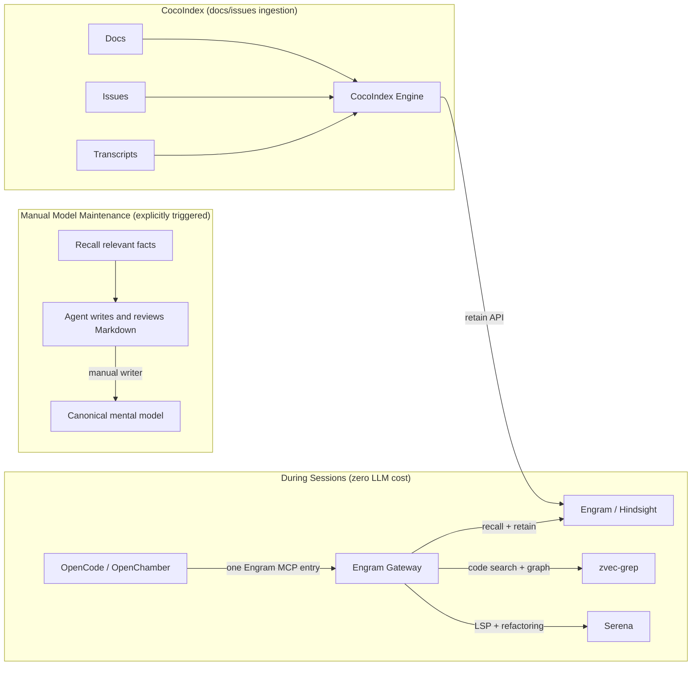
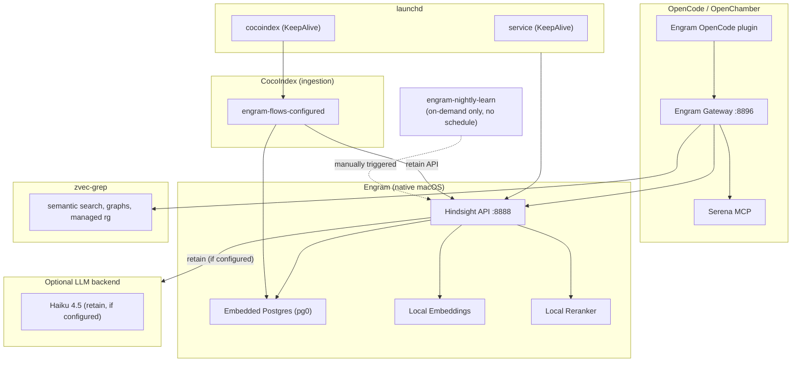

# Engram

**Makes your OpenCode/OpenChamber agent more effective by grounding it in an accurate,
current understanding of your codebase and its history.**

An agent's biggest bottleneck isn't typing speed — it's rebuilding context.
Left alone, it re-derives "what calls this," "why was it built this way,"
and "is this still true" from scratch every session, via long chains of
grep/glob/read sweeps, or worse, from stale training data that doesn't
reflect what's actually in the repo today. Engram closes that gap: a
call graph and knowledge graph built directly from your live corpus (code,
docs, issues, and past corrections), curated into mental models and
surfaced automatically — so reviews and new features are grounded in what's
*actually* true right now, not an approximation.

Needing fewer exploratory sweeps to reach that accuracy is also, naturally,
cheaper — reduced token consumption is a measured side effect of this, not
the goal (see [Value](#value-measuring-effectiveness) below).

> **Migration status (2026-11-24):** the client-facing gateway is Rust
> (`engram-mcp`, port 8898); the Python gateway is rollback-only. Serena,
> CocoIndex/search, Python ingestion, the Python Hindsight proxy, and the
> flows server are **still Python**. The runtime is not fully migrated, and
> the Python code cannot be deleted yet. Final removal is tracked in
> [#232](https://github.com/jordigilh/engram/issues/232). Architecture text
> below that mentions `:8896` or CocoIndex ingestion describes the
> pre-cutover topology unless it says otherwise.

## How it works



**Recall is local and free** — embeddings and reranking run on-device. The
default local configuration caps cross-encoder reranking at 50 candidates to
bound CPU and interactive latency; increase it when deeper reranking is worth
the cost.
Retain and triage maintenance are on-demand only, triggered explicitly in-chat
or by hand. The always-on CocoIndex flow calls the Hindsight retain API
automatically for docs, issues, and transcript changes. When retain extraction
is configured to use an LLM, that flow can spend tokens without a maintenance
command. Mental models are different: the agent recalls the relevant facts,
writes and reviews complete Markdown, then stores it through the manual
mental-model writer. The gateway does not expose Hindsight's Vertex-backed
`reflect`, `create_mental_model`, or `refresh_mental_model` operations.

## Four services, distinct benefits

Engram combines four complementary services behind one gateway. They are not
interchangeable ways to search the same data:

- **Hindsight remembers and serves** — persistent corrections, decisions,
  conventions, and manually authored mental models survive across sessions.
  Its knowledge graph connects entities and facts so recall can surface related
  context, not just exact text matches.
- **CocoIndex ingests and keeps the corpus fresh** — live filesystem/GitHub
  ingestion feeds Hindsight's document banks for docs, issues, and transcripts.
  CocoIndex is ingestion-only: it does not serve code search.
- **zvec-grep searches code** — per-workspace semantic search, structural
  pattern search (`search_for_pattern`), managed ripgrep, and call-graph/code-graph
  queries all come from the zvec-grep MCP daemon.
- **Serena knows and edits exact code** — language-server-backed symbol lookup,
  references, diagnostics, semantic rename, and body replacement operate on
  the current checkout with compiler-level semantics.

The gateway exposes these capabilities as one project-scoped MCP server, so
OpenCode/OpenChamber gets the combined benefit without managing four backend
registrations.

## What it solves

Four components, each closing a different gap, working together:

| Problem | How Engram fixes it |
|---------|-------------------|
| Agent burns many grep/glob/read sweeps just to answer "what calls this" or "how does X work" | Structural graph queries (`zvec_grep_callgraph_*` / `zvec_grep_codegraph_*`, served by the zvec-grep MCP daemon through the Engram gateway) + hybrid/structural code search answer relational and semantic questions directly, in one call |
| Training data and mental context go stale the moment code changes, risking wrong or outdated reviews/features | **CocoIndex** live-syncs docs/issues/transcripts, and **zvec-grep** refreshes the requested code workspace on a gateway search (waiting for indexing) while direct clients use eventual freshness |
| Reviews and new features can contradict past decisions or repeat already-solved mistakes | **Hindsight**'s knowledge graph + mental models surface prior corrections, conventions, and architecture decisions automatically |
| Every session starts with amnesia, repeating the same mistakes | **Hindsight**'s recall surfaces past corrections automatically; they become persistent patterns |
| Text-based rename/refactor risks missed references or false-positive matches across languages | **Serena**'s LSP-backed `rename_symbol`/`replace_symbol_body` apply refactors via real compiler semantics, language-agnostically |
| No way to know if any of this is actually helping | Weekly trend metrics track corrections, rework, exploration efficiency, and productivity over time |
| *(side effect)* Exploration and rework waste tokens | Fewer sweeps + fewer repeated mistakes → lower token cost — tracked as a metric, not the primary goal |

Each component covers genuinely distinct ground and none can substitute for
the others — see [docs/README.md's Division of Labor](docs/README.md#hindsight-vs-cocoindex-vs-zvec-grep-vs-serena-division-of-labor)
for the full breakdown of how CocoIndex, zvec-grep, Hindsight, and Serena divide
responsibility.

## Key features

- **Call-graph queries via the zvec-grep daemon** — structural graph queries that answer relational questions grep/glob can't: blast radius ("what breaks if I change this"), shortest path between two functions, and compiler-attested code-graph navigation, resolved with certainty classes instead of name matching. The earlier Graphify-inspired CocoIndex spike was retired (issue [#199](https://github.com/jordigilh/engram/issues/199)); its history is recorded in [docs/CALL_GRAPH_CLUSTERING.md](docs/CALL_GRAPH_CLUSTERING.md) and [docs/COCOINDEX.md#graphify-inspired-call-graph-queries](docs/COCOINDEX.md#graphify-inspired-call-graph-queries)
- **LSP-backed code intelligence, language-agnostic by construction** — the same tool surface (`find_symbol`/`find_referencing_symbols`/diagnostics) works identically whether the repo is Go, Python, Rust, or TypeScript, wrapping each language's real LSP (`gopls`, `pyright`, `rust-analyzer`, `typescript-language-server`). Includes **semantic refactoring** (`rename_symbol`, `replace_symbol_body`): a rename or body replacement is resolved and applied via the compiler's own understanding of the code, not text search-replace, so every real reference updates correctly and an unrelated same-named match elsewhere is never touched — see [docs/NEW_PROJECT_SETUP.md](docs/NEW_PROJECT_SETUP.md#code-intelligence) for setup
- **Hybrid code search via zvec-grep** — per-workspace indexes combine lexical and vector retrieval; results carry bounded source snippets and freshness metadata
- **Structural pattern search** — zvec-grep's `search_for_pattern` runs tree-sitter by-example matching to answer "find code shaped like X" (e.g. every function matching a signature)
- **Fresh code search** — CocoIndex watches docs/issues/transcripts. Gateway code searches refresh the requested zvec-grep workspace and wait for indexing before they return. Direct zvec-grep clients use eventual freshness and may not yet reflect recent edits.
- **Hindsight knowledge graph** — entities link across sessions for richer retrieval
- **Mental models** — agent-authored, curated documents (not scattered facts)
- **Learns from corrections** — detects when you correct the agent, extracts the lesson
- **Zero-cost recall** — local vector search, no tokens consumed during work
- **Multi-bank architecture** — behavioral memory + project docs + GitHub issues/PRs + code index
- **Self-cleaning** — on-demand triage removes ephemeral, stale, and duplicate memories
- **Self-evaluating** — weekly trend metrics (corrections/session, rework %, exploration efficiency, productivity density), ingestion coverage, data freshness
- **Recoverable** — transcripts are source of truth; `python3 -m engram.maintenance.recover_memories --apply` re-extracts recoverable corrections and instructions

See [docs/README.md's Division of Labor](docs/README.md#hindsight-vs-cocoindex-vs-zvec-grep-vs-serena-division-of-labor) for which of Hindsight, CocoIndex, zvec-grep, or Serena is responsible for each of these.

## Quick start

```bash
git clone https://github.com/jordigilh/engram.git
cd engram
```

Then follow the [Installation Guide](docs/INSTALL.md) (takes ~15 minutes) and
the [OpenCode/OpenChamber Integration](docs/OPENCODE.md) guide.
On Linux/Fedora/RHEL, use [`docs/INSTALL-linux.md`](docs/INSTALL-linux.md) instead
for the platform-specific steps (containerized Hindsight via Podman Quadlets and
native ingestion via systemd) — the rest of the guide applies
unchanged on either platform.

## Architecture



## Value: measuring effectiveness

The goal is more effective, more accurate reviews and feature work — fewer
wrong assumptions, fewer contradicted decisions, fewer sweeps to find the
right context. Engram tracks its own impact through **weekly trend metrics**
that measure recall sessions over time. By tracking within the same cohort
(sessions that use recall), week over week, we avoid selection bias and get a
clear signal.

**Key metrics tracked weekly:**

| Metric | What it measures | Goal |
|--------|-----------------|------|
| **Corrections/session** | User corrections per session | Lower = fewer mistakes |
| **Exploration efficiency** | grep/glob/search calls needed to reach relevant context | Lower = fewer sweeps, more direct answers |
| **Rework %** | Tokens spent on correction loops (a downstream side effect of the above, not the primary goal) | Lower = less waste |
| **Productivity density** | Productive actions per 1K tokens | Higher = more efficient |
| **First productive turn** | Turn where real work starts | Lower = faster ramp-up |

Token/cost savings follow directly from fewer exploration sweeps and fewer
correction loops — see [docs/METRICS.md](docs/METRICS.md#token-and-cost-side-effects)
for the measured numbers; this README leads with the accuracy/effectiveness
story since that's the actual goal.

> Run `python3 -m engram.maintenance.report` to see your weekly trends and session stats.
> The [Effectiveness Dashboard](docs/DASHBOARD.md) updates whenever `engram-nightly-learn`
> is run (on-demand — see [How it works](#how-it-works) above).

## Expected benefits from CocoIndex integration

CocoIndex replaces batch scripts with continuous, incremental ingestion for
docs, issues, and transcripts. Code search is served separately by zvec-grep
over per-workspace indexes. The expected improvements:

| Dimension | Before (batch scripts) | After (current stack) |
|-----------|----------------------|-----------------------|
| **Issues coverage** | 500 items (hardcoded cap) | All issues + PRs (~1,471 items) |
| **Issues freshness** | ~24 hours (nightly batch) | < 5 minutes (polling every 300s) |
| **Docs freshness** | Manual re-run | Instant (filesystem watching) |
| **Code search** | Not available | zvec-grep hybrid lexical + vector search over per-workspace indexes |
| **Transcript learning** | Nightly batch only | Continuous detection (regex, zero LLM cost) + on-demand extraction |
| **Exploration overhead** | Agent greps/globs for context | Recall front-loads synthesized knowledge |

**How to measure whether it's working:**

```bash
# Full effectiveness report with all metrics
python3 -m engram.maintenance.report

# Take a baseline snapshot before changes
python3 -m engram.maintenance.report --snapshot

# Compare against a previous baseline
python3 -m engram.maintenance.report --compare ~/.engram/logs/baseline-2026-06-22.json
```

Key metrics to watch (see [Value](#value-measuring-effectiveness) above for
the full list and what each one means):
- **Exploration efficiency** — are recall sessions needing fewer grep/glob calls?
- **Ingestion coverage** — is everything indexed?
- **Data freshness** — is the data current?

## Documentation

| Doc | Content |
|-----|---------|
| [Installation Guide](docs/INSTALL.md) | Full setup, prerequisites, verification (macOS-native Hindsight) |
| [OpenCode/OpenChamber Integration](docs/OPENCODE.md) | Unified gateway plugin, project identity, and MCP setup |
| [Linux/Fedora/RHEL Installation](docs/INSTALL-linux.md) | Platform-specific steps: containerized Hindsight (Podman Quadlet), systemd timers |
| [Legacy Cursor Installation](docs/INSTALL.md) | Existing Cursor setup and compatibility instructions |
| [Architecture & Internals](docs/README.md) | Design decisions, knowledge graph, correction detection |
| [CocoIndex Operations](docs/COCOINDEX.md) | Flow catalog, running modes, monitoring, troubleshooting |
| [Call-Graph Design](docs/CALL_GRAPH_DESIGN.md) | How call-graph extraction, resolution, clustering, and caching actually work |
| [Call-Graph Findings](docs/CALL_GRAPH_CLUSTERING.md) | Chronological spike + multi-org rollout findings, bugs found, precision measurements |
| [Metrics & Monitoring](docs/METRICS.md) | Effectiveness tracking, proactive recall, triage, report interpretation |
| [MCP Response-Shaping Spike](docs/MCP_RESPONSE_SHAPING_BENCHMARK.md) | Disabled lossless response-shaping experiment and live findings |
| [Effectiveness Dashboard](docs/DASHBOARD.md) | Daily metrics trend, updated on-demand via `engram-nightly-learn` |
| [Research Findings](docs/FINDINGS.md) | Empirical results, incidents, and lessons learned |

## License

MIT
